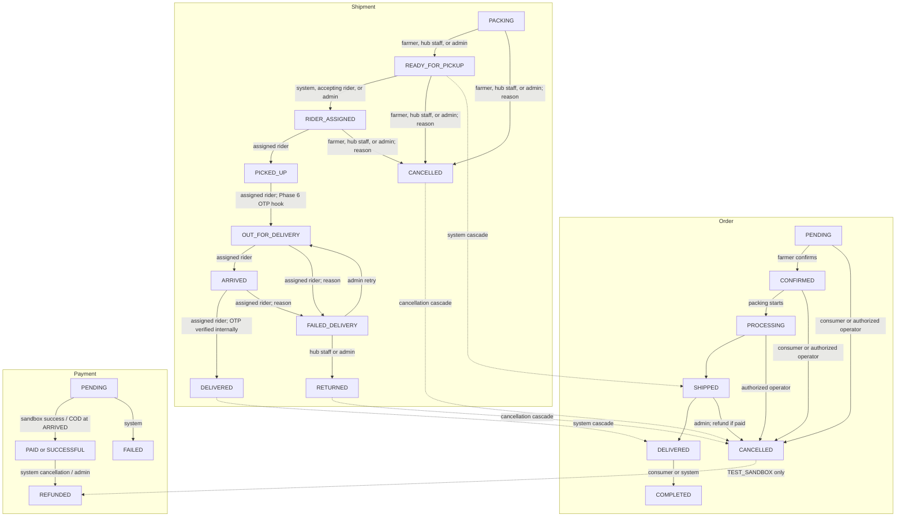

# Order, Shipment, and Payment Lifecycle

`OrderLifecycleService` is the single mutation boundary for order, legacy
delivery, shipment, and payment statuses. Each mutation locks the order row and
the affected child row with `SELECT ... FOR UPDATE`, changes status, appends an
`order_events` row, and stages notifications in the same database transaction.
`OrderEvent.note` stores the supplied reason; its `from_status` and `to_status`
identify the state values. A repeated transition returns a conflict before any
event or notification is added.

## Order transitions

| From | To | Allowed actor | Reason |
|---|---|---|---|
| PENDING | CONFIRMED | Farmer who owns an order listing, assigned hub staff, admin | Optional |
| PENDING, CONFIRMED | CANCELLED | Owning consumer; or order farmer, assigned hub staff, admin | Required for farmer, hub staff, and admin |
| CONFIRMED | PROCESSING | Order farmer, assigned hub staff, admin | Optional |
| PROCESSING | SHIPPED | System cascade when shipment becomes READY_FOR_PICKUP | Recorded by cascade |
| PROCESSING | CANCELLED | Order farmer, assigned hub staff, admin | Required |
| SHIPPED | DELIVERED | System cascade when shipment becomes DELIVERED after OTP verification | Recorded by cascade |
| SHIPPED | CANCELLED | Admin only | Required; refunds an eligible sandbox payment |
| DELIVERED | COMPLETED | Owning consumer or system | Optional |
| COMPLETED, CANCELLED | — | Terminal | — |

## Shipment transitions

The Phase 1 schema had no packing/pending state. Revision
`b7c4d2e9f1a0` adds `PACKING` as the initial shipment state, defaults newly
created rows to it, and does not rewrite existing shipment rows.

| From | To | Allowed actor | Reason |
|---|---|---|---|
| Initial (new row) | PACKING | Order farmer, assigned hub staff, admin | Optional |
| PACKING | READY_FOR_PICKUP | Order farmer, assigned hub staff, admin | Optional |
| READY_FOR_PICKUP | RIDER_ASSIGNED | System, accepting approved rider, admin | Admin/system must identify an approved rider |
| RIDER_ASSIGNED | READY_FOR_PICKUP | System or admin | Unassignment/reassignment |
| RIDER_ASSIGNED | PICKED_UP | Assigned rider | Optional |
| PICKED_UP | OUT_FOR_DELIVERY | Assigned rider | Optional; invokes the optional Phase 6 OTP-generation hook |
| OUT_FOR_DELIVERY | ARRIVED | Assigned rider | Optional |
| ARRIVED | DELIVERED | Assigned rider, via internal OTP-verified method only | `otp_verified=True` is mandatory; no endpoint exposes this transition |
| OUT_FOR_DELIVERY, ARRIVED | FAILED_DELIVERY | Assigned rider | Required |
| FAILED_DELIVERY | RETURNED | Hub staff assigned to the hub or admin | Optional |
| FAILED_DELIVERY | OUT_FOR_DELIVERY | Admin | Optional; retry |
| PACKING, READY_FOR_PICKUP, RIDER_ASSIGNED | CANCELLED | Order farmer, assigned hub staff, admin | Required; cascades order cancellation and eligible sandbox refund |
| DELIVERED, RETURNED, CANCELLED | — | Terminal | — |

Cancelling an order while its shipment is still PACKING cancels both records in
the same transaction and writes an event for each status change.

## Payment transitions

`PaymentStatus.SUCCESSFUL` is the existing API/database success value for the
`PAID` transition. Sandbox success continues returning `successful` for API
compatibility; COD uses `PAID`. `FAILED` and `REFUNDED` retain their existing
names.

| From | To | Allowed actor | Reason |
|---|---|---|---|
| PENDING | PAID (`SUCCESSFUL` for legacy sandbox success) | System sandbox result; assigned rider for COD only when shipment is ARRIVED | Optional |
| PENDING | FAILED | System | Optional |
| PAID, SUCCESSFUL | REFUNDED | System on cancellation, or admin | Admin must provide a reason; test/sandbox records only |

The existing sandbox endpoint also accepts its legacy `cancelled` outcome and
stores `PaymentStatus.CANCELLED` from `PENDING`. This compatibility transition
is an explicit extension beyond the requested payment table. No live gateway
or real refund is implemented.

## Legacy Delivery compatibility

The existing `/orders/{order_id}/fulfillment/status` contract remains in place.
Legacy `Delivery` values stay distinct from `ShipmentStatus`, but their status
changes now use the lifecycle service and are audited:

| Legacy delivery status | Aggregate order effect |
|---|---|
| CONFIRMED | PENDING (if applicable) → CONFIRMED → PROCESSING |
| READY or OUT_FOR_DELIVERY | PROCESSING → SHIPPED (system compatibility cascade) |
| DELIVERED or PICKED_UP | SHIPPED → DELIVERED (system compatibility cascade) |
| CANCELLED | Eligible non-terminal order → CANCELLED |

These compatibility cascades preserve farmer delivery and pickup behavior
without fabricating a `Shipment` row. New hub fulfillment uses the shipment
state machine; consumer completion remains the existing order status action.

## Who may do what

| Actor | Order | Shipment | Payment |
|---|---|---|---|
| Consumer | Cancel own PENDING/CONFIRMED order; confirm receipt after DELIVERED | No direct status changes | Initiate own TEST_SANDBOX payment |
| Farmer | Confirm, begin processing, or cancel own order with reason; update existing delivery/pickup | Prepare and mark ready or cancel own order shipment | No direct payment changes |
| Hub staff | Confirm, begin processing, or cancel orders at assigned hub (reason for cancel) | Prepare, mark ready, return, or cancel shipments at assigned hub | No direct payment changes |
| Rider | No direct order status changes | Approved riders may accept assignments and update only their assigned shipment; failed-delivery reason required | Record COD cash only for assigned shipment at ARRIVED |
| Admin | Confirm, begin processing, cancel eligible orders; shipped cancellation requires reason | Assign/unassign, retry, return, or cancel with reason | Refund TEST_SANDBOX payment with reason |
| System | Internal shipment/order cascades and sandbox outcomes | Internal assignment/unassignment support; OTP delivery remains internal | Sandbox result, eligible sandbox cancellation refund |

The lifecycle service persists money from the server-side order total. It accepts
no client-supplied amount.
